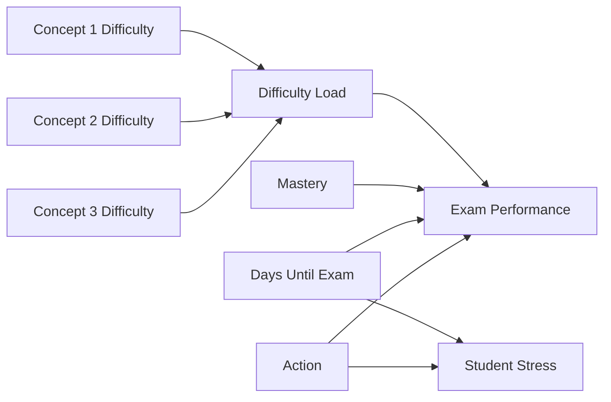

# Bayesian Network

I used 9 variables. The student gives one mastery rating for the whole exam and one difficulty rating for each concept. The planner counts the days from each study date to the exam date.

| Variable             | States                                               | Parents                                           |
| -------------------- | ---------------------------------------------------- | ------------------------------------------------- |
| Concept 1 Difficulty | easy, hard                                           | None                                              |
| Concept 2 Difficulty | easy, hard                                           | None                                              |
| Concept 3 Difficulty | easy, hard                                           | None                                              |
| Difficulty Load      | 0, 1, 2, 3                                           | The three concept difficulties                    |
| Mastery              | low, medium, high                                    | None                                              |
| Days Until Exam      | far (7 days or more), near (3 to 6), urgent (1 or 2) | None                                              |
| Action               | rest (0 hours), light (1 hour), focused (5 hours)    | None                                              |
| Exam Performance     | low, medium, high                                    | Mastery, Difficulty Load, Days Until Exam, Action |
| Student Stress       | low, medium, high                                    | Days Until Exam, Action                           |



## CPTs

I set the probabilities by hand based on how I expect a student to study. In each `TabularCPD`, the rows follow `state_names` and the columns follow the combinations of the parent states. Each column sums to 1. `study-planner cpts` prints one column per line.

For each concept, easy and hard both have probability 0.5. For Mastery, Days Until Exam and Action, each of the 3 states has probability 1/3. These are uniform because I give all 6 states to the query each time. Action also has a CPT because it is a variable in the Bayes net. I set its value before each query, so the program does not use its prior to pick an action.

Difficulty Load counts the hard concepts. For `hard, easy, hard` the count is 2, so the CPT column is `(0, 0, 1, 0)`. I gave each concept the same weight. This makes the performance CPT the same for any combination with 2 hard concepts.

### Exam Performance

I treat the exam as two parts with the same chance `p` of getting each part right. The two parts are independent in this calculation. Getting 0, 1 or 2 parts right gives low, medium or high performance.

```text
p = mastery base - 0.10 * number of hard concepts + time margin + study gain
```

| Mastery | Base |
| ------- | ---: |
| low     | 0.44 |
| medium  | 0.65 |
| high    | 0.87 |

| Days Until Exam | Time margin |
| --------------- | ----------: |
| far             |        0.09 |
| near            |        0.05 |
| urgent          |           0 |

| Action  | Study gain for d hard concepts | Fraction of gain used on urgent days |
| ------- | -----------------------------: | -----------------------------------: |
| rest    |                              0 |                                    1 |
| light   |              `0.08 + 0.02 * d` |                                 0.75 |
| focused |              `0.10 + 0.11 * d` |                                 0.45 |

I used 0.87 for high mastery because I expect a student who knows the material to get most questions right. I used 0.44 for low mastery, which gives the student some chance of getting a part right. Each hard concept takes off 0.10. The gain for focused study goes up by 0.11 per hard concept because 5 hours gives the student more time to work through those topics. I gave the student an extra 0.09 with at least a week left and 0.05 with 3 to 6 days left, since they still have time to go over the topics again. In the final 2 days I used 75% of the light study gain and 45% of the focused study gain. I expect a student to get less out of doing most of the work in one long session right before the exam.

I keep `p` between 0.05 and 0.98 so each outcome is still possible. The CPT has 108 columns. The entries in each column are `(1-p)^2`, `2*p*(1-p)` and `p^2`, in low, medium, high order. For low mastery with 3 hard concepts and 7 days left, focused study gives `p = 0.44 - 0.30 + 0.09 + 0.43 = 0.66`. The column is `(0.1156, 0.4488, 0.4356)`.

### Student Stress

| Days Until Exam | Action  |  Low | Medium | High |
| --------------- | ------- | ---: | -----: | ---: |
| far             | rest    | 0.90 |   0.09 | 0.01 |
| far             | light   | 0.60 |   0.35 | 0.05 |
| far             | focused | 0.25 |   0.55 | 0.20 |
| near            | rest    | 0.85 |   0.13 | 0.02 |
| near            | light   | 0.45 |   0.45 | 0.10 |
| near            | focused | 0.15 |   0.50 | 0.35 |
| urgent          | rest    | 0.55 |   0.35 | 0.10 |
| urgent          | light   | 0.35 |   0.45 | 0.20 |
| urgent          | focused | 0.04 |   0.26 | 0.70 |

For rest, I set the chance of high stress to 1% with at least a week left and 10% with 1 or 2 days left. I expect the exam itself to cause some stress even if the student takes the day off. For a 5 hour session, the chance goes from 20% to 70%. A long session close to the exam gives the student less time to go back over anything they are still stuck on. I used the same table for each student.

## Inference and utility

The evidence is the 3 concept difficulties, mastery, days until the exam and the action. I queried Exam Performance and Student Stress together with pgmpy's `VariableElimination`, using `MinFill`. The query sums over Difficulty Load since I give the concept ratings as evidence. I ran the same query 3 times, changing Action from rest to light to focused.

| Level  | Performance points | Stress points to subtract |
| ------ | -----------------: | ------------------------: |
| low    |                  0 |                         0 |
| medium |                 50 |                        20 |
| high   |                100 |                        50 |

`get_utility()` subtracts the stress points from the performance points. The cost of high stress is 50, which cancels out one step up in performance. `score_actions()` multiplies the utility of each of the 9 pairs by its probability and adds the results. In the example above, focused study gives `0.4488 * 50 + 0.4356 * 100 = 66` performance points on average. The expected stress cost is `0.55 * 20 + 0.20 * 50 = 21`. The expected utility is `66 - 21 = 45`.

The program chooses the highest score out of the actions that fit. If two scores are equal, it chooses the shorter action. It uses the same mastery rating for the whole run. After a student has studied, they can run it again with a new rating.

## Demo results

These are the scores seven days before the exam. Each case has the same exam date and the same available hours.

1. Low mastery, 3 hard concepts. The scores for rest, light and focused are 20.70, 27.50 and 45.00. Focused has the highest score, so the program schedules 5 hours. With 2 days left, the chance of high stress for focused goes up to 70% and its score falls to −6.85. Light has the highest score on that day at 5.50.
2. Low mastery, 1 hard concept. The same 3 scores are 40.70, 43.50 and 43.00. Light is ahead of focused by 0.50, so the program schedules 1 hour. I kept mastery and the date the same as in case 1, so this change comes from the difficulty ratings.
3. High mastery, 3 easy concepts. The scores are 93.70, 88.50 and 77.00. The chance of high performance is about 92% with rest and 96% with either study action. In this case the small increase does not cover the stress cost, so the program leaves the day free.
